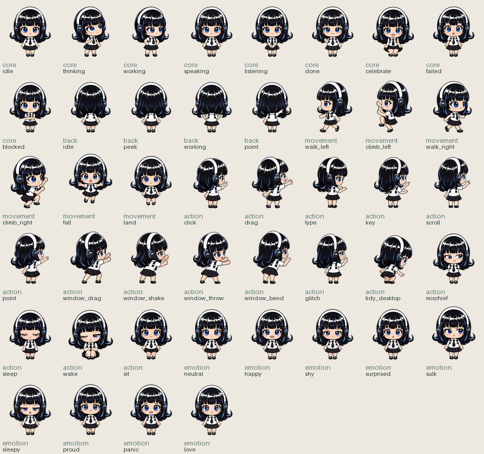
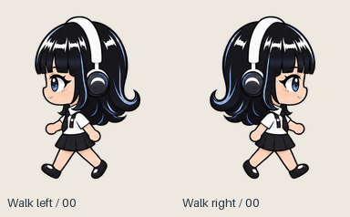
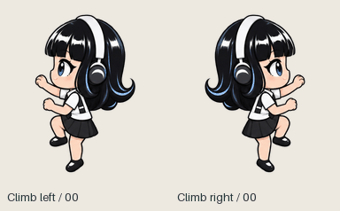
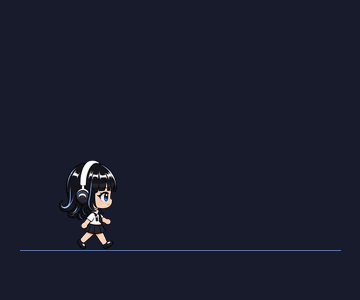
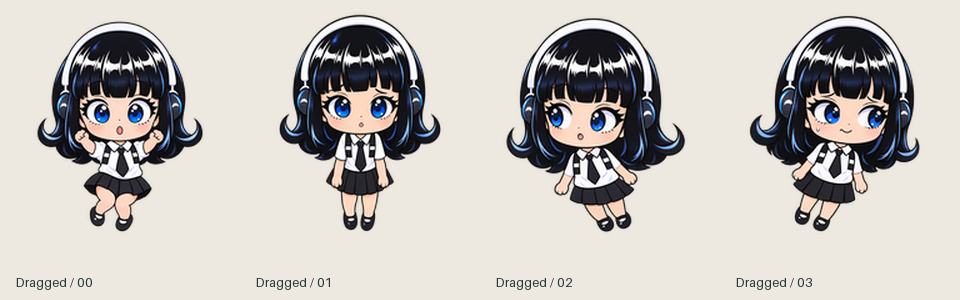
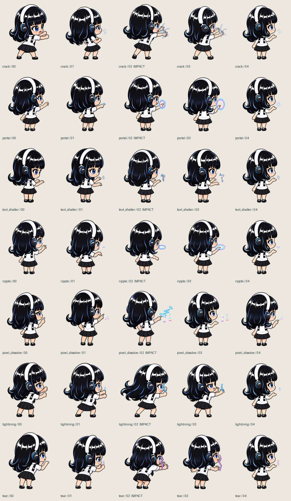

<p align="center">
  
</p>

<h1 align="center">Hermes-chan</h1>

<p align="center">
  <b>Your AI agent finally has a body.</b><br>
  A chibi desktop companion for <a href="https://hermes-agent.nousresearch.com/">Hermes Agent</a> who walks your screen,
  climbs your windows, watches videos with you, pranks your apps,<br>
  and performs the agent's real clicks and keystrokes with her own hands.
</p>

<p align="center">
  <a href="#status"></a>
  <a href="#platforms"></a>
  <a href="LICENSE"></a>
  <a href="#open-source"></a>
  <a href="https://hermes-agent.nousresearch.com/"></a>
  
  <a href="https://github.com/AlleyBo55/hermes-chan/actions/workflows/build.yml"></a>
</p>

<p align="center">
  <a href="#install-in-one-message">Install</a> ·
  <a href="#what-she-can-do">What she can do</a> ·
  <a href="#switch-her-on-and-off">On / off</a> ·
  <a href="#commands">Commands</a> ·
  <a href="#safety-and-privacy">Safety</a> ·
  <a href="#open-source">Contribute</a>
</p>

<p align="center">
  
  
  
</p>

## Install in one message

Hermes can install her for you. Paste this into a Hermes chat:

```text
Install the Hermes-chan desktop companion plugin from https://github.com/AlleyBo55/hermes-chan

1. Run: hermes plugins install https://github.com/AlleyBo55/hermes-chan --enable
2. Check that Rust 1.90 or newer is installed (`cargo --version`). If it is missing,
   install it from https://rustup.rs; if it is older, run `rustup update`.
   - Linux: she also needs the WebKitGTK build packages listed in the README's
     "Install by hand" section.
   - Windows: Rust needs the Visual Studio C++ Build Tools.
   If a step needs admin rights (sudo, an installer), give me the exact command
   instead of running it.
3. Build her body: cargo build --release --locked --manifest-path <plugin folder>/overlay/src-tauri/Cargo.toml
   The plugin folder is plugins/hermes-chan inside my Hermes home
   (~/.hermes on macOS and Linux, %LOCALAPPDATA%\hermes on Windows).
4. Optional: run `hermes config set computer_use.backend hermes-chan` so she
   performs your computer-use clicks and typing.
5. Ask me whether her chat box may post what I type into it to my Hermes chats.
   If I say yes, run:
   hermes config set plugins.entries.hermes-chan.allow_gateway_injection true
6. Tell me when it's done. She appears in my next session, or right away with /hermeschan on.
```

The first build compiles the Rust crates and takes a few minutes; later builds take seconds.
If you skip step 3, she builds herself in the background on first start (when `cargo` is
installed) and writes the progress to `build.log`.

## Status

**Working.** The plugin, the Rust/Tauri body and a 52-clip sprite pack (289 frames) are wired up
and running on all three desktop systems.

<a id="platforms"></a>

| Platform | Status | Native input | Notes |
| --- | --- | --- | --- |
| **macOS** 12+ | ✅ Tested end to end | CoreGraphics + System Events | Asks for Accessibility and Screen Recording |
| **Linux** (X11, or XWayland on Wayland) | ✅ Tested end to end on X11 | XTest | On Wayland she only sees and acts on X11/XWayland apps |
| **Windows** 10 / 11 | 🧪 Beta: builds and links; not yet run on a real Windows machine | SendInput | She cannot move or type into apps running as administrator |

Found something odd on your machine? [Open an issue](https://github.com/AlleyBo55/hermes-chan/issues),
it helps a lot.

## What she can do

### 🏃 She lives on your screen like a shimeji
- **Walks** the bottom of your screen with an 8-frame walk cycle matched to her stride (60 px/s),
  so her feet never slide.
- **Hops up the scene one step at a time.** Each hop is about 5% of the screen height. She lands,
  stands on that height as if it were a step, walks along it, then hops up again or back down.
- **Climbs** the edges of the screen and the sides of the window you are using, to a random
  height. She hangs on, climbs higher, or lets go and falls.
- **Stands on windows and rides them.** Every visible window's top edge is a ledge. Move the
  window and she moves with it; close it and she falls.
- **Falls with gravity.** Drag her (she dangles in her own "dragged" pose) and let go: she falls
  all the way down and lands with a little crouch.
- **Follows you everywhere.** On macOS she climbs over the menu bar and joins you on other Spaces
  and in full-screen apps; on Linux she stays with you across workspaces.

<p align="center">
  
</p>

### 👀 She notices what you are doing
- **Watches videos with you.** Focus a YouTube, Netflix, Twitch, Prime Video, Disney+, Vimeo,
  Bilibili or Crunchyroll tab, or a player such as VLC, mpv, IINA, QuickTime, Infuse, the TV app,
  Media Player, MPC-HC, PotPlayer or GNOME Videos, and she walks over, sits under the video with
  her back to you, and watches. Now and then she turns round to react ("popcorn time!", "did you
  see that?"). Switch away and she leaves.
- **Works along with you.** In a code editor or terminal (**Kiro**, VS Code, Cursor, Windsurf,
  Zed, Xcode, JetBrains IDEs, Sublime Text, Android Studio, Terminal, iTerm, Warp, Ghostty, kitty,
  WezTerm, Alacritty, Windows Terminal, PowerShell, GNOME Terminal, Konsole) she stands by the
  window in her "working" pose.
- **Visits the window you switch to.** Most of the time when you change windows she heads over
  to peek at it, point at it or climb its side.
- **Mumbles to herself.** 510 idle lines and 219 video reactions, one every minute or two, each
  list shuffled so nothing repeats until all have played. Local and free: no model call.

### ✨ She plays pranks on your apps
Every prank has its own casting animation, and its effect fires on that animation's impact
frame, starting at her hand. All effects are drawn on a separate click-through layer above the
app, so the app itself never changes and looks normal again a moment later.

| Prank | What you see |
| --- | --- |
| Crack | the screen cracks from her fist |
| Portal | a swirling portal opens in front of her |
| Break font | the window's text shatters into flying glyphs |
| Collapse | a snapshot of the window cracks and falls apart into a dark void, then the real app is back |
| Tear | the window rips open |
| Ripple, pixel dissolve, lightning | ripples, pixels and bolts burst from her hand |
| Glitch, bend | scanlines, colour split and blocks, or the window's border bends |

<p align="center">
  
</p>

Try every effect in [the local effects preview](overlay/src/effects-preview.html), and every
sprite clip in [the sprite review page](sprites/hermeschan-v1/index.html).

**She also moves real windows, carefully.** On her own she can shake the window you are using,
nudge it sideways, fling it, or pull it down, timed to her grab frame. She only does this after
20 seconds with no keyboard or mouse input, only on the active window, and she puts it back
2.5 seconds later unless you moved it yourself. While you are working she bends the window
instead.

### 🤖 She is the agent's body
- **Real computer use, performed by her.** Set `computer_use.backend: hermes-chan` and every
  click, drag, scroll and keystroke the agent makes is animated by her: she reaches out, and her
  Rust body sends the native input on the sprite's contact frame. Approval stays in Hermes, above
  her.
- **Lives the agent's state.** Thinking, working, waiting for your approval, done and celebrating
  each have their own animation.
- **Talks with you.** Ctrl+click her (or right-click) to open the chat box above her head. What
  you type becomes a normal user turn in Hermes, and the reply shows in her bubble. Enter sends,
  Esc closes.
- **Has a life between turns.** An optional heartbeat asks the model for one tiny in-character
  reaction (cheap, not a full turn), so she can comment on what you are doing.

## Switch her on and off

| How | What happens |
| --- | --- |
| **Ctrl+Shift+click** on her | She leaves: her process ends and she disappears. She comes back with `/hermeschan on`, when you switch the plugin off and on, or when Hermes restarts |
| `/hermeschan off` · `/hermeschan on` | The same from any Hermes chat; `on` brings her straight back |
| Closing her window (Alt+F4 on Windows and Linux) | Same as Ctrl+Shift+click |
| `hermes plugins disable hermes-chan` · `enable` | Unloads or loads the whole plugin (tools, hooks and her body). This is the switch that lasts: to keep her off, turn the plugin off. The Plugins switch in Hermes Desktop and the `hermes plugins` picker do the same |

Hermes plugins are opt-in: a fresh install is off until you enable it (`--enable` in the install
command does that). The 📌 button above her head switches between **follow** (she perches by the
active window and watches it) and **roam** (everything in [What she can do](#what-she-can-do)).

## Install by hand

**1. Prerequisites**

| | You need |
| --- | --- |
| All | [Hermes Agent](https://hermes-agent.nousresearch.com/) 0.23+, [Rust](https://rustup.rs) 1.90+ |
| macOS | Xcode Command Line Tools: `xcode-select --install` |
| Windows | [Visual Studio C++ Build Tools](https://visualstudio.microsoft.com/visual-cpp-build-tools/) ("Desktop development with C++") and the WebView2 runtime (already on Windows 11 and updated Windows 10) |
| Debian / Ubuntu | `sudo apt install libwebkit2gtk-4.1-dev build-essential curl wget file libxdo-dev libssl-dev libayatana-appindicator3-dev librsvg2-dev` |
| Fedora | `sudo dnf install webkit2gtk4.1-devel openssl-devel curl wget file libappindicator-gtk3-devel librsvg2-devel libxdo-devel` and `sudo dnf group install c-development` |
| Arch | `sudo pacman -S --needed webkit2gtk-4.1 base-devel curl wget file openssl appmenu-gtk-module libappindicator-gtk3 librsvg xdotool` |

**2. Install, build, start**

```bash
hermes plugins install https://github.com/AlleyBo55/hermes-chan --enable
cd ~/.hermes/plugins/hermes-chan/overlay/src-tauri      # Windows: %LOCALAPPDATA%\hermes\plugins\hermes-chan\overlay\src-tauri
cargo build --release --locked
```

Start a Hermes session (CLI, TUI or the Desktop app) and she appears a couple of seconds later.
`/hermeschan status` tells you what her body is doing and why, if she is not there.

**From a clone (developers).** `./run.sh` links your checkout into `~/.hermes/plugins`, enables
it and builds her body (macOS and Linux). `cd overlay/src-tauri && cargo run` runs the body on its
own; Ctrl+Shift+click her to quit.

## Commands

```text
/hermeschan status | on | off | come | sleep | wake | hide | say <text>
/hermeschan resummon        # stuck or lost? restart her fresh (keeps mischief/watch/heartbeat)
/hermeschan effect <name>   # crack, portal, text_shatter, ripple, pixel_dissolve, lightning, tear, glitch, bend
/hermeschan mischief on|off # her own pranks, effects and window moves
/hermeschan watch on|off | react
/hermeschan heartbeat on|off|status [interval]
```

## Configuration

| Setting | Default | Meaning |
| --- | --- | --- |
| `computer_use.backend: hermes-chan` | off | she performs the agent's computer-use actions |
| `plugins.entries.hermes-chan.allow_gateway_injection: true` | off | lets what you type into her bubble reach your chat (CLI, TUI or Desktop app); run any `/hermeschan` command in the chat you want her to talk to first |
| `HERMESCHAN_AUTOSTART` | `1` | `0` keeps her body from starting at all |
| `HERMESCHAN_BUILD` | `1` | `0` stops her from building her body when no fresh build exists |
| `HERMESCHAN_OVERLAY_BIN` | unset | use this overlay binary instead of the plugin's own build |
| `HERMESCHAN_BUILD_TIMEOUT` | `1800` | seconds the automatic build may take |
| `HERMESCHAN_SOCKET` | `<Hermes home>/hermes-chan.sock` | macOS/Linux bridge socket |

Set config keys with `hermes config set <key> <value>`, for example
`hermes config set plugins.entries.hermes-chan.allow_gateway_injection true`.

Her files live in `<Hermes home>/hermes-chan/`: `settings.json`, `overlay.json` (where she
stands), `build.log`, `overlay.log`, the tidy journal, and on Windows `bridge.json`.

### Permissions

| System | What she asks for | Without it |
| --- | --- | --- |
| macOS | **Accessibility** (read and move the active window, native input) | she still roams, but can't perch, follow or move windows |
| macOS | **Screen Recording** (the collapse snapshot, the heartbeat's optional glance) | she does a different prank instead |
| macOS | **Automation** for System Events and Finder (window titles, real `tidy_desktop` moves) | no app-aware reactions; tidying stays a plan |
| Windows | nothing | apps running as administrator are off limits (Windows UIPI) |
| Linux | nothing; an X11 display (XWayland counts) | native Wayland apps are invisible to her |

If anything is missing she fails cleanly and keeps animating. On macOS the entry to turn on is
usually **`osascript`**, because Hermes starts its background gateway through `/usr/bin/osascript`
and she runs inside that gateway ([details](INSTALL.md#5-grant-permissions-macos-only)).

## Safety and privacy

- Her pranks are drawn on a click-through overlay. They never change an app's memory, content
  or files.
- She moves a real window only after you have been idle for 20 seconds, only the active window,
  and she puts it back. `/hermeschan mischief off` stops all her pranks.
- As the `computer_use` backend she acts only through Hermes' approval system and adds no bypass.
- `tidy_desktop` is plan-first: running it needs a short-lived plan token plus `confirm=true`,
  journals each move first, never overwrites a file, skips hidden and system files, and can be
  undone.
- The bridge between Hermes and her body is local only: an owner-only socket on macOS and Linux,
  and on Windows a `127.0.0.1` port that accepts only the random token of the body Hermes started.
- She makes no network calls of her own, sends no telemetry and never reads credentials. Window
  snapshots stay in memory on your machine.
- She ends with Hermes. Unattended runs (CI, kanban workers) never start her body.

## Troubleshooting

| Symptom | Fix |
| --- | --- |
| She doesn't appear | `/hermeschan status` shows the reason; check `build.log` and `overlay.log` in `<Hermes home>/hermes-chan/` |
| `/hermeschan status` says she is away | `/hermeschan on`, or switch the plugin off and on (Ctrl+Shift+click sent her away) |
| The plugin doesn't load at all | `hermes plugins enable hermes-chan`, then start a new session |
| Linux: black box instead of a transparent window | run a compositor (most desktops do); on some GPU drivers set `WEBKIT_DISABLE_DMABUF_RENDERER=1` |
| Linux: "no graphical display" | Hermes' gateway runs without your session's display, usually as a systemd service: `systemctl --user import-environment DISPLAY WAYLAND_DISPLAY XAUTHORITY`, then `hermes gateway restart` |
| Chat bubble says Hermes blocks her chat box | `hermes config set plugins.entries.hermes-chan.allow_gateway_injection true`; it works on the next message, no restart |
| Chat bubble says Hermes did not take the message | send any `/hermeschan` command in the chat you want her to talk to, then try again |
| She is stuck, lost off screen or acting odd | `/hermeschan resummon` |
| Windows: she can't touch one app | that app runs as administrator; Windows blocks input from normal apps into it |

## Evidence

Measured on a 1512×982 MacBook screen while building these features:

| What | Measured |
| --- | --- |
| Window motion while walking | a position update every 16.7 ms (60 fps), 1-2 px per step |
| Walking speed | about 63 px/s, matching a 22 px step twice per 720 ms cycle |
| Hops | 49 px steps: floor (733) to 684 to 635, walked along it, back down to the floor |
| Climb | from the floor to y = -133, above the menu bar, then a fall and a clean landing |
| Video watching | walked to the video's centre in 4 s, watched for 31 s, left 1 s after the tab changed |
| Window ledges | reads every on-screen window (owner, layer, bounds) once a second, no Screen Recording needed |
| Sprite pack | 52 clips, 289 frames; standing clips share one feet line (feet at row 197 of 208) |
| Lines | 510 idle mumbles and 219 video reactions, all unique, at most 49 characters |

On Linux (X11 with openbox and picom) the same end-to-end run connects her, follows the active
window, roams, climbs the screen edge and stands on a window's top edge; XTest clicks, typing (a
shell command typed into xterm ran), key combos and scrolling all land; Ctrl+Shift+click ends her
process; `/hermeschan on`, `off` and plugin unload behave as documented.

## Open source

Hermes-chan is **100% open source under the [MIT license](LICENSE)**. No binaries are shipped:
her body is built from the Rust source in this repository on your own machine, so everything
that runs is something you can read.

| Folder | What lives there |
| --- | --- |
| [`hermeschan/`](hermeschan) + [`__init__.py`](__init__.py) | the Python plugin: tools, hooks, `/hermeschan`, the bridge, the computer-use backend |
| [`overlay/src-tauri/`](overlay/src-tauri) | her Rust/Tauri body: window tracking, native input, effects, one module per OS |
| [`overlay/src/`](overlay/src) | the webview: sprite player, roaming brain, effects, speech bubble |
| [`sprites/`](sprites) | the sprite pack, its spec and the tools that build it |

Read [ARCHITECTURE.md](ARCHITECTURE.md) for how the pieces talk. Issues and pull requests are
welcome: new pranks, new lines, better platform support, translations, bug reports from your
desktop. Please keep the [safety rules](#safety-and-privacy) intact.

## License

Code is [MIT](LICENSE). The sprite artwork draws on the supplied Nous Girl portrait; the code
license is not a claim of independent rights to the Nous Research character or the source
illustration. See [the sprite spec](sprites/SPRITE_SPEC.md).
